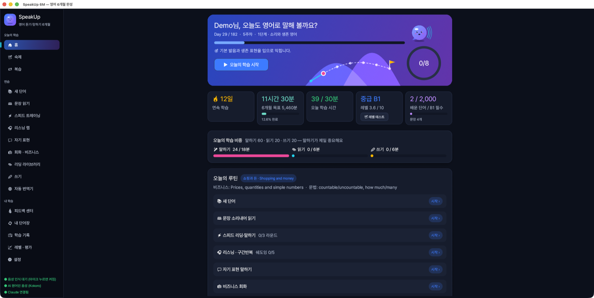
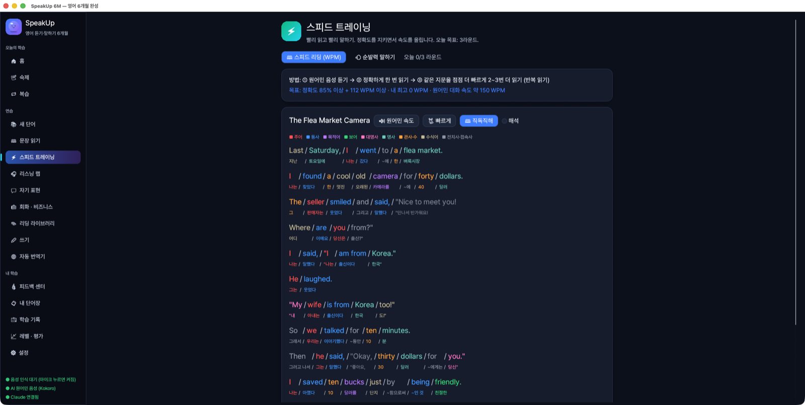
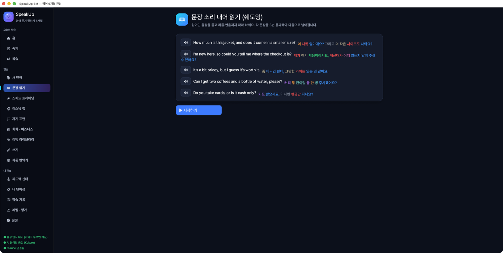

# 🎤 SpeakUp 6M — 6개월 영어 듣기·말하기 완성

**6개월 뒤, 영어로 듣고 말할 수 있게.** SpeakUp 6M은 소리로 알려 주고, 내 목소리를 듣고, 잘 따라 했는지 바로 알려 주는 **음성 중심 영어 학습 데스크톱 앱**입니다. macOS와 Windows에서 동작하며 웹 브라우저가 아닌 네이티브 앱(Rust)입니다.

> 학습 비중은 **말하기 60 · 읽기 20 · 쓰기 20**. 말하기가 제일 중요합니다.



---

## ⬇ 설치

[Releases](https://github.com/moonlightpark/Speakup-6months/releases/latest)에서 내 컴퓨터에 맞는 파일을 받으세요.

| OS | 파일 | 실행 방법 |
|---|---|---|
| macOS (Apple Silicon) | `SpeakUp6M-macos-arm64.zip` | 압축을 풀고 `SpeakUp 6M.app` 실행. 처음에 "확인되지 않은 개발자" 경고가 뜨면 앱을 **우클릭 → 열기** |
| Windows | `SpeakUp6M-windows-x64.zip` | 압축을 푼 폴더에서 `speakup.exe` 실행 (같은 폴더의 `.dll` 파일을 지우지 마세요) |

---

## 🚀 처음 시작하기 (5분)

1. **이름**과 **Claude API 키**를 입력합니다. 한 번 입력하면 다시 묻지 않아요.
2. **음성 인식 모델**(142MB)을 받습니다 — 내 발음을 알아듣는 데 씁니다.
3. **자연스러운 AI 음성**(약 330MB)을 받습니다 — 원어민처럼 매끄러운 목소리로 읽어 줍니다.
4. **마이크·스피커 점검**: 3초 말하고 다시 들어 보세요.
5. **레벨 테스트**를 보면 내 수준에 맞는 6개월(182일) 과정이 시작됩니다.

모델은 **한 번만** 받으면 되고, 이후에는 인터넷 없이도 음성 인식과 음성 재생이 됩니다.

---

## 📅 하루 학습 루틴

홈 화면의 **오늘의 루틴**을 위에서부터 차례로 하면 됩니다. 매일 내용이 바뀌고, 이미 배운 문장은 다시 나오지 않습니다 (복습은 따로).

| 순서 | 학습 | 하는 일 |
|---|---|---|
| 📝 | 숙제 확인 | 어제 어려워한 문장·단어를 다시 말해 확인받기 |
| 🔁 | 복습 | 배운 단어·문장을 잊어버릴 때쯤 다시 (간격 반복 SRS) |
| 📚 | 새 단어 | 듣고 → 소리 내어 여러 번 → 예문까지. **💬 오늘의 원어민 표현·유행어** 2개 포함 |
| 📖 | 문장 읽기 | 원어민 문장을 소리 내어 읽기, 단어별로 초록(맞음)/빨강(틀림) 표시 |
| ⚡ | 스피드 트레이닝 | 빨리 읽기(WPM 측정)와 순발력 말하기 |
| 🎧 | 리스닝 랩 | 유튜브 원어민 영상을 자막 단위로 구간 반복, 쉐도잉 |
| 💬 | 자기 표현 | 내 이야기를 영어로 30~60초 말하고 AI 피드백 받기 |
| 💼 | 비즈니스 회화 | AI와 상황극(회의, 면접, 식당 등) |
| 📘 | 리딩 | 내 수준에 맞는 동화·소설 읽기 |
| ✏ | 쓰기 | 받아쓰기 · 한→영 작문 · 영어 일기 |

홈 화면의 **오늘의 학습 비중**에서 말하기·읽기·쓰기 시간을 목표(60:20:20) 대비로 확인할 수 있어요.

---

## ✨ 주요 기능

### 🎤 따라 말하기 채점
마이크 버튼을 누르고 말하면, 오프라인 음성 인식(Whisper)이 알아듣고 **단어마다 맞았는지** 색으로 보여 줍니다. 통과할 때까지 여러 번 소리 내어 읽게 하고, 말하기 속도(WPM)도 알려 줍니다.

### 🔊 자연스러운 원어민 음성
신경망 음성 합성 **Kokoro**로 사람처럼 매끄럽게 읽어 줍니다. 미국·영국 남녀 11가지 목소리 중에서 고를 수 있고, **🐢 천천히 / 🐇 빠르게**도 자연스럽습니다. 한 번 들은 문장은 바로 다시 재생됩니다.

### 📖 직독직해
영어 어순 그대로 끊어 읽고, 각 조각 아래에 한글 뜻을 보여 줍니다.

```
I  /  am  /  a  /  boy
나 /  이다 /  한 / 소년
```

조각마다 **문장 성분 색상**이 붙습니다. 중요한 주어·동사는 진하게, 덜 중요한 말일수록 회색에 가깝게 표시합니다.

| 색 | 성분 | 예 |
|---|---|---|
| 🟥 빨강 | 주어 | I / 나 |
| 🟦 파랑 | 동사 | am / 이다 |
| 🟪 보라 | 목적어 | coffee / 커피를 |
| 🟩 초록 | 보어 | boy / 소년 |
| 🩷 분홍 | 대명사 | my / 내 |
| 🟧 주황 | 관사·수 | a / 한 |
| ⬜ 회색 계열 | 수식어 · 전치사·접속사 | very, in / 그리고 |

문장 해석, 작문 문제, 대화 번역 같은 **한글 지문도 같은 색으로** 표시합니다. 지문은 문장마다 줄을 바꾸고 문장 사이에 여백을 두어 읽기 편하게 했습니다. 눈이 피로하면 **설정 → 학습 → "한글 지문에 문장 성분 색상 표시"** 를 끄세요. 직독직해 색상은 📖 직독직해 버튼으로 따로 켜고 끕니다.





### 📘 리딩 라이브러리 — 동화책부터 소설까지
내 레벨에 맞는 책을 추천합니다.
- **동화**: 사자와 생쥐, 양치기 소년, 토끼와 거북이, 개미와 베짱이, 빨간 암탉, 골디락스, 미운 오리 새끼 (학습용으로 다시 쓴 이야기, 내장)
- **어린이 고전**: 피터 래빗, 오즈의 마법사, 이상한 나라의 앨리스
- **소설**: 비밀의 화원, 톰 소여의 모험, 크리스마스 캐럴, 셜록 홈즈, 위대한 개츠비, 오만과 편견

원문은 저작권이 끝난 퍼블릭 도메인 작품(Project Gutenberg)이라 무료로 한 번만 받아 둡니다. 문장을 누르면 **듣기 · 직독직해 · 소리 내어 읽기(채점) · 단어 뜻 · 복습 저장**을 할 수 있고, 어려우면 **✨ 쉬운 영어로 다시 쓰기**로 내 수준에 맞게 바꿔 읽을 수 있어요. 읽던 페이지는 자동으로 기억합니다.

### ✏ 쓰기
- **🎧 받아쓰기**: 배운 문장을 듣고 그대로 쓰기 (단어별 채점)
- **🔁 한→영 작문**: 한국어를 영어로. 모범 답안과 달라도 뜻이 같으면 AI가 맞다고 인정해요
- **📝 영어 일기**: 짧은 글을 쓰면 AI가 교정하고 원어민 버전을 보여 줍니다. 교정된 글은 **소리 내어 읽어서** 말하기 연습으로 이어져요

### 🌐 자동 번역기 — 한국어로 말하면 영어 3단계로
하고 싶은 말을 **한국어로 마이크에 말하거나** 입력하면, 같은 뜻을 **쉽게 · 중간 · 고급** 세 가지 영어 표현으로 바꿔 보여 주고 원어민 음성으로 읽어 줍니다. 표현마다 핵심 팁이 붙고, **🎤 따라 말하기**로 바로 연습하거나 **⭐ 저장**해서 복습에 넣을 수 있어요.

```
🎤 "오늘 회의 좀 미룰 수 있을까요?"
 쉽게  Can we move the meeting?
 중간  Could we push the meeting back a bit?
 고급  Would it be possible to reschedule today's meeting?
```

한국어 음성 인식 모델(466MB 또는 142MB)은 처음 한 번만 받습니다.

### 💬 원어민 표현과 유행어
교과서 문법 대신 원어민이 실제로 쓰는 문장으로 배웁니다. 매일 **예전부터 쓰던 표현**(my bad, rain check, as if! …) 하나와 **요즘 유행어**(no cap, low-key, it's giving… …) 하나를 배워요.

### 🔁 복습과 숙제
배운 단어·문장은 잊을 때쯤 다시 나옵니다(SM-2 간격 반복). 자꾸 틀리는 문장·단어는 **약점**으로 표시되어 더 여러 번 반복하고, 다음 날 **숙제**로 다시 확인합니다.

### 🔬 피드백 센터
자주 틀리는 발음 단어(3번 연속 맞히면 해결)와 AI가 교정해 준 문장을 모아 다시 연습합니다.

### 📈 레벨과 기록
레벨(초급~능숙, CEFR A1~C1)은 파일로 기록되고 4주마다 레벨 평가를 봅니다. **학습 기록**에서 날짜별로 무엇을 몇 분 했는지, 읽은 책, 쓴 글, 점수를 확인할 수 있어요.

---

## ❓ 자주 묻는 질문

**Claude API 키가 꼭 필요한가요?**
레슨 생성, 말하기·쓰기 피드백, AI 회화, 쉬운 영어로 다시 쓰기에 사용합니다. 키가 없어도 내장 레슨·동화·받아쓰기 등은 쓸 수 있어요. 키는 [Anthropic Console](https://console.anthropic.com/)에서 만들고, 내 컴퓨터에만 저장됩니다.

**마이크가 안 돼요.**
설정 → **오디오 장치 · 마이크 점검**에서 "마이크 테스트"를 눌러 보세요. 원인을 알려 줍니다.
- macOS: 시스템 설정 → 개인정보 보호 및 보안 → 마이크에서 SpeakUp 6M을 허용하세요.
- 맥북 **덮개를 닫고** 외부 모니터를 쓰면 내장 마이크가 꺼집니다. 덮개를 열거나 헤드셋 마이크를 연결하세요.

**소리가 안 나요 (macOS).**
앱 위쪽에 "시스템 오디오가 응답하지 않습니다"가 보이면 macOS 오디오가 멈춘 상태입니다. 터미널에서 `sudo killall coreaudiod`를 실행하세요.

**내 학습 기록은 어디에 저장되나요?**

| OS | 위치 |
|---|---|
| macOS | `~/Library/Application Support/com.SpeakUp.SpeakUp6M/` |
| Windows | `%APPDATA%\SpeakUp\SpeakUp6M\data\` |

**태블릿에서도 쓸 수 있나요?**
지금은 데스크톱 전용입니다. 학습 엔진은 Android/iOS로 옮길 수 있게 만들어져 있어, 나중에 iPad·안드로이드 패드처럼 큰 화면에서는 데스크톱과 같은 화면 구성으로 제공할 계획입니다.

---

## 🛠 직접 빌드하기

Rust 1.86 이상과 CMake가 필요합니다.

빌드는 메모리를 아끼도록 동시 작업 수를 4개로 제한해 두었습니다(`.cargo/config.toml`). 메모리가 넉넉하면 `cargo build -j 8`처럼 늘릴 수 있습니다.

```bash
cargo run --release              # 실행
cargo test                       # 테스트
./scripts/bundle_macos.sh        # macOS .app 만들기
```

## 🙏 사용한 오픈소스

[egui](https://github.com/emilk/egui) (화면) · [whisper.cpp](https://github.com/ggerganov/whisper.cpp) (음성 인식) · [Kokoro-82M](https://huggingface.co/hexgrad/Kokoro-82M) + [sherpa-onnx](https://github.com/k2-fsa/sherpa-onnx) (음성 합성) · [Pretendard](https://github.com/orioncactus/pretendard) (글꼴, SIL OFL) · [Project Gutenberg](https://www.gutenberg.org/) (퍼블릭 도메인 도서) · [yt-dlp](https://github.com/yt-dlp/yt-dlp) (유튜브) · [Claude API](https://www.anthropic.com/) (AI)
